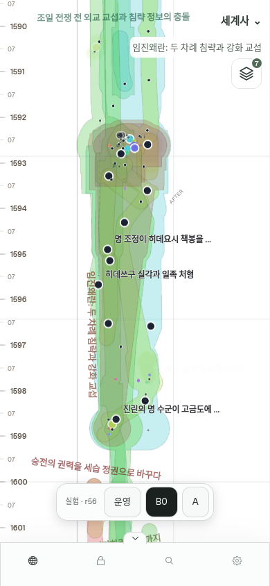
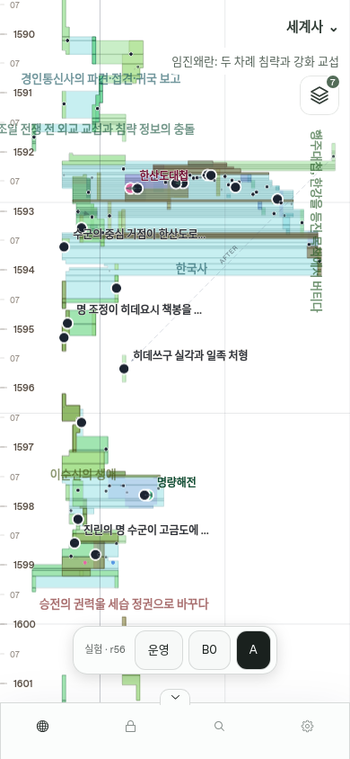

# TSTL 제품 실험실 · 2026-10-13

사용자 승인 [IP-016](../implementation/IP-016-tstl-product-lab.md)에 따라 설정의 선택형 실험실에서 실제 history-r56 B0/A를 비교한다. 별도 화면의 선·포트 비교를 넘어 기존 GraphShell의 면, 축별 확대, 순차적 비가시화, Collection, 선택과 drawer를 그대로 사용한다. 기본값은 현재 운영이다.

- [임진왜란 영역에서 후보 A 열기](https://moirai-production-8ed1.up.railway.app/graph/v5?world=01a107fb-4018-7fcb-8390-836a40fa91cc&layoutLab=A&gsViewport=300,223420,1400,1800)
- [설정](https://moirai-production-8ed1.up.railway.app/graph/settings?world=01a107fb-4018-7fcb-8390-836a40fa91cc)
- [PR #351](https://github.com/neocjmix/moirai/pull/351)

## 출처와 배포

문서 시작 커밋은 `0ead253b4cb71742d7c1ef78c480e66dff708a82`이다. 작업 시작·병합 전 main은 `d721b0efdcf309ed7ad21c55bc04572e2f14d644`였으며 feature branch의 조상이라 main 측 추가 차이와 병합 충돌은 없었다. baseline → 검증기 → 제한된 A → 독립 프리뷰의 기존 작은 커밋 뒤에 제품 데이터 adapter, 고정 윤곽 렌더러, 설정과 비교 도구, 발견한 회귀 수정과 브라우저 검증을 각각 커밋했다.

리뷰 소스는 `0c551356778a5afda2e049a20cff8490e9cfcb19`, PR #351의 main 병합·공개 검증 빌드는 `131611f63327e029bd14f46d31707946cd40568e`이다. 00:13:28 UTC에 병합했고 기존 main 연결 Railway 서비스 3개 모두 이 SHA로 SUCCESS다. 공개 Atropos status·health가 00:15:43 UTC부터 이 SHA와 HTTP 200을 반환했다. [배포·공개 불변성 기록](tstl-product-2026-10-13/deployment.json)이 직접 관측한 allowlisted 응답과 해시를 보존한다. 이후 문서 전용 커밋의 배포 SHA는 이 런타임 검증 SHA와 구분하며 현재 값은 `/__status`에서 관측한다.

00:16:21 UTC의 r56 served pointer는 418 bytes / SHA-256 `ef4c07b2b64188d0573ea4ab94e6e46b38765c7dc4b5b443047295586699072a`, Render manifest는 1,740,190 bytes / SHA-256 `14b3d11cb059175b634029145a8fe381049c489ce276a1bd101a0782c5bdcb36`로 배포 전후 정확히 동일했다. 새 서비스·환경·발행 작업은 만들지 않았고 기존 무관한 staged patch도 적용하지 않았다.

전체 고정 artifact는 `/labs/tstl/r56-be1265468d3f0a32.json`, SHA-256 `be1265468d3f0a32c939cf0f335df6b1050059241c4893f0a52806563045a65b`, 원본 880,345 bytes / gzip 134,428 bytes다. 브라우저에서 해시·World·r56·Time System·단일 ID를 검사한다. 최초 실험 선택 때 한 번 읽으며 카메라·Collection·B0/A 전환 중 새 viewport 발행이나 solver 실행은 없다.

역사 fixture SHA-256 `5957645873d0484244e317a99c459df025e2d80d07dc5819e79c62569c716b64`, source root `d2a6f32a3aec21e222c094363615c9f7ac4f8c3e0654106e3206c2c37d546a54`를 보존한다. 기존 [독립 프리뷰](https://neocjmix.github.io/moirai/tstl-candidate-a/)와 [당시 증거](tstl-candidate-a-preview-2026-10-13.md)는 별도로 유지한다.

## B0/A 비교

| 항목 | B0 | 후보 A |
|---|---|---|
| 데이터 | 같은 r56, 539 Event | 동일 ID·원래 Y, X만 변경 |
| Composite | 운영의 109개 geometry와 SHA 일치 | 105개 면 소유자, 분리 fragment 1,207개 |
| 윤곽 처리 | 기존 padding·spline·feather | 전달한 고정 M/L/Z 경로, fragment별 독립 triangulation |
| 축소·비가시화 | 기존 production 정책 | 같은 production 정책, 원래 Event/Composite Y anchor 보존 |
| 면 없는 사례 | 운영 표현 | 한산도대첩·명량해전·노량해전·안현전투를 점·목록으로 표시 |
| 의미 검증 | 원래 운영 면 | 검증 미완료 실험 면으로 명시 |

모든 A Event는 하나의 ID를 유지한다. 면 조각마다 Event를 복제하거나 떨어진 조각 사이를 연결하는 가짜 polygon을 만들지 않는다. worker와 cache에 모든 ring을 전달하고, 실제 그려지는 path의 좌표까지 source와 대조한다. HUD·label·hit·drawer miniature도 분리된 ring을 사용한다. 예전 scalar-only snapshot은 일부 원본 시간 지식을 빠뜨렸다는 뜻이며 면 생성 불가를 뜻하지 않는다. 기존 의미 검증기의 인증 조건을 완화하지 않고 실험 표시를 분리했다.

독립 검토는 [109/109 B0 Composite geometry](tstl-product-2026-10-13/b0-live-geometry-audit.json)를 공개 운영 manifest와 대조했고, 전체 World·임진왜란 두 카메라의 정착 후 admission ID와 geometry 외 필드도 대조했다. 검토 중 발견한 Composite Y midpoint 재계산과 World 세션 저장 prefix 누락을 수정했다. 모바일 검사에서 발견한 drawer의 비교 버튼 가림도 수정했다.

## 검증

로컬 Chromium desktop 1280×800, Chromium/WebKit mobile 390×844에서 전체 흐름이 통과했다. 공개 r56 RSC bootstrap을 그대로 읽은 임시 로컬 mount와 실제 공개 detail API를 사용했고, 임시 경로를 제거한 뒤 최종 production build를 다시 통과했다. 이 결과를 공개 운영 route의 증거와 혼동하지 않는다.

검사 항목은 새 브라우저의 현재 운영 기본값·실험 asset 요청 0, 실제 WebGL A 면, source ring 및 렌더링된 각 좌표 일치, B0/A 카메라 보존, 독립 X/Y pinch, 단일 사건 선택·drawer 유지, Collection 7→6→7, 전환 전체 asset 1회, 확대에 따른 admission 변화, 설정 저장·재진입·현재 운영 복귀다. 로컬 3개 프로필 모두 runtime error·실패 HTTP 0건이다.

**공개 운영 route에서도 동일한 3개 프로필이 모두 통과했다.** [공개 smoke 요약](tstl-product-2026-10-13/public-smoke.json)은 실제 `/graph/v5`, 배포 SHA `131611f`, 원본/asset 해시, 모든 관찰 항목, 화면 크기와 screenshot 해시를 기록한다. 최종 검사는 scene·worker 작업과 표현 전환 종료, live/committed 카메라 일치를 기다린 뒤 재확인했다. 런타임·HTTP 오류 0, 가로 overflow 0이다.

| 공개 프로필 | 결과 | 임진왜란 A의 고정 면 소유자 / fragment | 실제 WebGL mesh |
|---|---|---|---|
| Desktop Chromium 1280×800 | PASS | 50 / 968 | 50 |
| Mobile Chromium 390×844 | PASS | 50 / 968 | 49 |
| Mobile WebKit 390×844 | PASS | 50 / 968 | 49 |

넓은 화면에서는 desktop에 105개 면 / 1,207 fragment, mobile 두 엔진에 101개 면 / 1,200 fragment가 남아 기존 density 정책을 따른다. 한산도대첩 `01a107ff-8b3c-75eb-bc17-7166e9061e76`을 선택해 A/B0 왕복 중 동일 ID와 drawer·카메라 유지를 확인했다. 이 사건은 이순신·임진왜란·한국사·일본사 ancestry를 공유하며 A의 명시적 점 fallback 사례다. GPU mesh는 일반 Float32 정밀도를 사용하며 화면 경로 검사는 affine projection의 수치 허용 오차를 사용한다.

| Mobile WebKit B0 | 같은 카메라의 후보 A |
|---|---|
|  |  |

[설정 화면](tstl-product-2026-10-13/mobile-webkit-settings.png) · [공유 사건 drawer와 비교 도구](tstl-product-2026-10-13/mobile-webkit-selected-event.png)

데이터·렌더러 focused tests, strict typecheck, lint, architecture boundaries, format, production build, secret scan을 통과했다. 전체 로컬 unit 실행은 892 pass / 2 skip / 1 failure였고, 실패한 기존 CI OIDC lifetime 테스트는 별도 재실행 3/3 pass다. 이 테스트는 한 실행 안에서 기준 초가 바뀌면 `now+301`이 허용 300초 범위가 되는 경계가 있다. dependency audit은 high/critical 0, 기존 moderate 9다. 현재 HEAD의 CI와 공개 검증 결과를 함께 기록한다.

초기 제품 checkpoint `033d127`의 CI mobile/secret 검사는 성공, scale matrix는 14/15 성공이었다. 한 실패는 기존 합성 dense 1k Collection 전환 max 111ms > 100ms이며 p95 17ms, page error 0이었다. 당시 quality는 생성 JSON format에서 중단됐고 hash로 고정한 생성물의 formatter 제외 및 README format을 수정했다. 이를 최신 HEAD의 전체 품질 검사 성공으로 대신 주장하지 않는다.

**최신 배포 main `131611f`의 [CI #38326175407](https://github.com/neocjmix/moirai/actions/runs/38326175407)는 quality·mobile-playwright·secret-scan 모두 SUCCESS다.** Format, lint, boundaries, strict typecheck, 전체 unit, PostgreSQL migration integration, production build와 high-level dependency audit를 통과했다. 이 실제 결과가 앞선 formatter 실패 및 로컬의 한 clock-sensitive 실패와 구분되는 최종 품질 결과다.

## 남은 한계

- 제한된 X-only 후보 A다. 실제 r56 계산은 1,000,000 constraint-visit budget을 소진해 deterministic feasible fallback을 사용하며 원래 증거의 max constraint violation은 0이다. 최적해나 전체 A0 공동 경계 최적화를 완료했다고 주장하지 않는다. B/C는 구현하지 않았다.
- 단일 run constructor가 다루지 못하는 multi-run band 518개는 비어 있으며, 면 교차의 모든 연결 영역에 사건 witness가 보장되지는 않는다. 면의 의미 인증을 통과한 제품 승격으로 해석하지 않는다.
- 고정 r56만 비교한다. revision이 달라지면 실험 선택을 비활성화하며 detail도 같은 revision guard를 사용한다. 역사와 served pointer·운영 기본값·Render generation을 변경하지 않았다.
- 실험 scope-wide 한계는 지속 표시되는 실험 control과 설정 설명에 둔다. viewport마다 동일 진단을 console에 반복하지 않는다.
- Cloud browser emulation 결과다. 실제 iPhone 17 Safari 및 설치형 PWA의 체감·메모리·GPU 검증은 남는다. 기존 frame 수치 gate 미달만으로 종료된 광범위 성능 튜닝을 재개하지 않는다.
